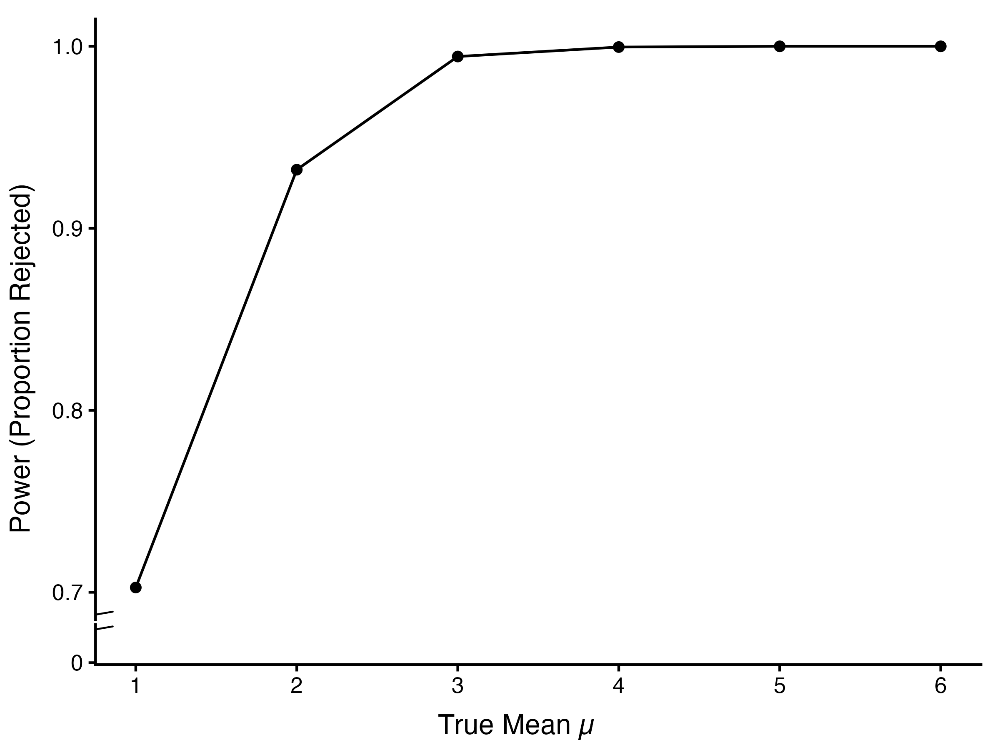
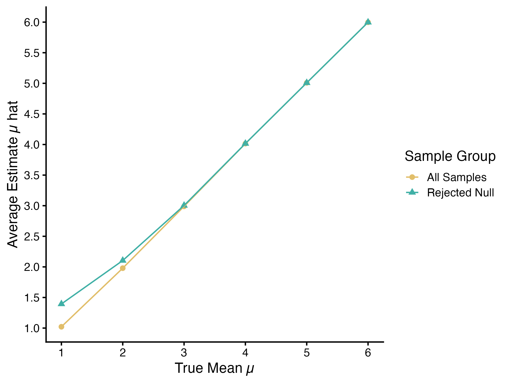

HW 5: Iteration
================
Hongtong Lin
2026-11-14

## Problem 2

Tidy the data

``` r
long_study_df <- tibble(
  file_path = list.files(path = "data/", pattern = "\\.csv$", full.names = TRUE)
) |> 
  mutate(
    data = map(file_path, read_csv),
    arm = str_sub(basename(file_path), 1, 3),
    id = str_sub(basename(file_path), 5, 6)
  ) |> 
  relocate(arm, id) |>
  select(-file_path) |> 
  unnest(data) |> 
  pivot_longer(
    cols = week_1:week_8,
    names_to = "week",
    names_prefix = "week_",
    values_to = "observation"
  ) |> 
  mutate(
    arm = recode(
      arm,
      "con" = "control",
      "exp" = "experimental"
    ),
    week = as.integer(week)
  )
```

Spagehetti Plot

``` r
long_study_df |> 
  ggplot(aes(x = week, y = observation, color = arm,
             group = interaction(arm, id))) + # each subject gets their own continuous line 
  geom_point(alpha = 0.5) + 
  geom_line() + 
  scale_x_continuous(breaks = 1:8) +
  scale_color_viridis_d(
    name = "Study Arm",
    labels = c("control" = "Control", "experimental" = "Experimental"),
    begin = 0.75,
    end = 0.25
  ) + 
  labs(
    title = "Longitudinal Study Outcomes Over Time",
    x = "Week", 
    y = "Observation"
  ) + 
  theme_classic(base_size = 16) + # font size to 14
  theme(
    plot.title = element_text(hjust = 0.5),
    legend.position = "bottom"
  )
```


## Problem 3

``` r
set.seed(10000)
```

write the simulation function

``` r
sim_t_test <- function(mean, n = 30, sigma = 5){
  
  x <- rnorm(n, mean = mean, sd = sigma)
  
  result <-
    t.test(x, mu = 0, conf.level = 0.95) |> 
    broom::tidy() |> 
    select(mu_hat = estimate, p_value = p.value)

  return(result)
}
```

run 5000 simulations for a vector of true mu

``` r
sim_results <- 
  expand_grid(
    true_mu = 0:6,
    iter = 1:5000
  ) |> 
  mutate(
    result_df = map(true_mu, sim_t_test)
  ) |> 
  unnest(result_df)

glimpse(sim_results)
```

    ## Rows: 35,000
    ## Columns: 4
    ## $ true_mu <int> 0, 0, 0, 0, 0, 0, 0, 0, 0, 0, 0, 0, 0, 0, 0, 0, 0, 0, 0, 0, 0,…
    ## $ iter    <int> 1, 2, 3, 4, 5, 6, 7, 8, 9, 10, 11, 12, 13, 14, 15, 16, 17, 18,…
    ## $ mu_hat  <dbl> -0.1430427, 0.9388986, 1.1349217, 1.2242345, -0.8494669, -0.13…
    ## $ p_value <dbl> 0.850780650, 0.285539714, 0.368133868, 0.085921631, 0.34170782…

Power vs true value of mean

``` r
sim_results |> 
  mutate(rejected = p_value < 0.5) |> 
  filter(true_mu > 0) |> 
  group_by(true_mu) |> 
  summarize(power = mean(rejected)) |> 
  ggplot(aes(x = true_mu, y = power)) + 
  geom_point() + 
  geom_line() + 
  scale_x_continuous(breaks = 1:6) + 
  scale_y_continuous(
    limits = c(0,1),
    breaks = c(0, 0.1, seq(0.7, 1.0, by = 0.1))
    ) + 
  ggbreak::scale_y_break(
    breaks = c(0.01, 0.7), 
    scales = 15,           # higher scale, taller the 0.7-1.0 range
    symbol = "slash"       # Adds the // break marks on the axis
  ) + 
  labs(
    x = "True Mean µ",
    y = "Power (Proportion Rejected)"
  ) + 
  theme_classic(base_size = 16)
```



Standardized Effect Size is:

$$
d = \frac{\mu - \mu_0}{\sigma}
$$\
So in this case,\
$$
d = \frac{\mu - 0}{5} = \frac{\mu}{5}
$$\
That means, when true mean increases, the effect size also increases.
The plot shows that when the true mean increases, power also increases,
so there is a positive association between effect size and power.

Average µ hat v.s true mean plot

``` r
all_samples <- 
  sim_results |> 
  filter(true_mu > 0) |> 
  group_by(true_mu) |> 
  summarise(avg_estimate_mu = mean(mu_hat)) |> 
  mutate(group = "All Samples") |>  relocate(group)


rejected_samples <- 
  sim_results |> 
  mutate(rejected = p_value < 0.5) |> 
  filter(true_mu > 0, 
         rejected == TRUE) |> 
  group_by(true_mu) |> 
  summarise(avg_estimate_mu = mean(mu_hat)) |> 
  mutate(group = "Rejected Null") |>
  relocate(group)


all_samples |> 
  bind_rows(rejected_samples) |> 
  ggplot(aes(x = true_mu, y = avg_estimate_mu, color = group, shape = group)) + 
  geom_point(size = 2.5) + 
  geom_line() + 
  scale_color_manual(values = c("#e1be6a", "#40b0a6")) + 
  scale_shape_manual(values = c(16, 17)) +
  scale_x_continuous(breaks = 1:6) + 
  scale_y_continuous(breaks = seq(1, 6, by = 0.5)) + 
  labs(
    x = "True Mean µ",
    y = "Average Estimate µ hat",
    color = "Sample Group",
    shape = "Sample Group"
  ) + 
  theme_classic(base_size = 16) 
```



``` r
all_samples |> 
  bind_rows(rejected_samples) |> 
  pivot_wider(
    names_from = group,
    values_from = avg_estimate_mu
  )
```

    ## # A tibble: 6 × 3
    ##   true_mu `All Samples` `Rejected Null`
    ##     <int>         <dbl>           <dbl>
    ## 1       1          1.02            1.39
    ## 2       2          1.98            2.10
    ## 3       3          2.99            3.00
    ## 4       4          4.01            4.02
    ## 5       5          5.01            5.01
    ## 6       6          6.00            6.00

The sample average of µ hat among rejected tests is not equal to the
true µ when true mean is low (µ = 1, 2, 3) or when the effect size is
small. However, when true mean or effect size increases, the deviation
from the sample average of µ hat among reject tests to the true µ is
getting smaller and smaller. And when true µ reaches 4, the sample
average of µ hat among rejected tests is almost the same as the true
mean.

With n=30 and sigma=5 fixed, the sample average µ hat needs to be ≥ 1.8
to get p\<0.05 and reject the null. When the true mean or effect size is
small, the average can barely be ≥1.8. Only a small sample or the lucky
sample can pass the test or reject the null. However, if the true mean µ
is already big enough, that means the sample values are already ≥1.8, so
almost every value can pass the test or reject the null.
